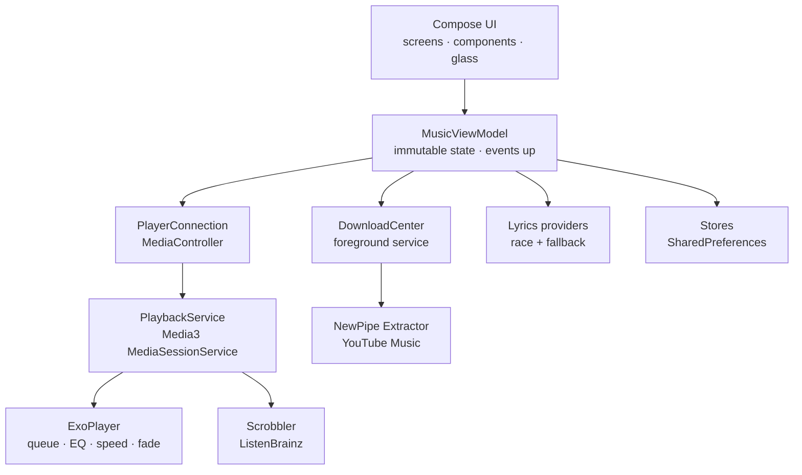

<div align="center">
  <h1>Dopavin</h1>
  <p><strong>Music, your way.</strong></p>

  <p>
    
    
    
    
    
    
  </p>

  <p>
    <a href="#features">Features</a> ·
    <a href="#install">Install</a> ·
    <a href="#build-from-source">Build</a> ·
    <a href="#tech-stack">Tech stack</a> ·
    <a href="#credits">Credits</a> ·
    <a href="#license">License</a>
  </p>
</div>

**Dopavin** is a downloads-first music player for Android. Search YouTube Music, keep the songs you love on your phone, and play them offline — in a player that looks as good as it sounds.

No account. No ads. No analytics. No subscription. Just your music, on your device.

The name comes from **dopamine + veena**: the rush of a favourite song, and the instrument at the heart of it.

> [!NOTE]
> **Status:** v1.2 is the current version and the project is under active development. The core player is complete; some newer and optional integrations (ListenBrainz, Subsonic, YouTube Music sign-in, Android Auto) are still being verified and marked experimental. Screenshots will be added with the first public release.

---

## Why Dopavin?

- **Offline first.** A downloaded song plays from a local file, instantly. Your library does not depend on a server staying up or a licence being renewed.
- **Your data stays yours.** Likes, playlists, history, subscriptions and settings live on the phone. There is no account to create and nothing is collected.
- **Built for the ear and the eye.** Media3 handles playback properly, while Compose draws an artwork-led, liquid-glass interface with real motion, not decoration.
- **Deliberately small.** No Room, Hilt, KSP, Coil or Navigation-Compose. Fewer moving parts, easier to read, faster to build.
- **GPL-3.0, forever.** The full source is here. Read it, learn from it, fork it, improve it.

## Features

### Playback

- Background playback through a Media3 `MediaSessionService`, with a notification (previous, play/pause, next, repeat, close), lock-screen, headset-button and Android Auto controls
- Queue with drag-to-reorder (the list scrolls by itself near its edges), swipe-to-remove with undo, and "You / Auto" provenance chips
- Real shuffle order: the queue you see is the queue that plays
- Equalizer with bass boost and virtualizer
- Playback speed with pitch lock, skip silence, sleep timer with fade-out, fade between songs
- Smart autoplay that keeps about ten related songs queued ahead; it does not mix your downloads into a streamed queue unless you are offline
- Last queue and playback position restored on launch

### Discover

- YouTube Music search with filter chips, "Did you mean", recent searches, artist / album / song results and "Show more results" paging
- Home feed: continue listening, subscriptions, trending, radio, genres and moods
- Your own country's charts and genre tiles that follow your phone's languages (Hindi, Punjabi, Tamil, Telugu, Malayalam, Kannada, Bengali, Spanish, Arabic, Korean ...) and what you play. Country and language are read from the phone; you are never asked for them
- A short first-run welcome with a few artists to pick, so Home starts personal (everything can be skipped)
- Artist pages with local Subscribe, shuffle and the artist's songs
- Song radio, mood queues and a Personal Mix, driven by a deterministic, unit-tested scorer
- Latest releases and new-release detection from official channels

### Library and downloads

- Download any song for offline playback; downloaded songs play from the local file
- Favourites, playlists, recently played, multi-select actions and duplicate handling
- Wi-Fi-only downloads, download quality, storage dashboard, "Save to device", Download all and auto-resume on reconnect
- Backup and restore of favourites, playlists and settings to a file you choose

### Lyrics

- Synced lyrics from seven sources with a race and fallback chain: lrc.red / BiniLyrics, Better Lyrics, Better Lyrics Portato, LyricsPlus, Unison, KuGou and LRCLIB
- One priority: word-synced first, then line-synced, then plain text; later title variants are tried only to find a better kind, and failures are shown in plain words
- Word-by-word (karaoke) highlighting when the source provides syllable timing
- Tap a line to seek; current line on the player; generated lyrics card to share

### Personalisation and services

- Light and dark themes, artwork-tinted Now Playing, cover art shared between the mini player and the full player
- Gradient-free surfaces everywhere, including a flat neutral artwork placeholder while a cover loads
- Liquid-glass tab bar, mini player, buttons, menus and sheets — with a solid fallback on older devices or when animations are off
- Predictive back, Reduce Motion support and a Driving mode
- Home-screen widget, Recap, share song / artist, Spotify link import
- Optional: ListenBrainz scrobbling, your own Subsonic-compatible server, YouTube Music sign-in to import likes and playlists
- In-app update check from GitHub Releases: an Update available dialog with the release notes, then download and install after you confirm
- Settings > Contributors with the GitHub profile pictures of the people behind Dopavin

### Accessibility

Accessibility is a build rule, not an afterthought:

- Minimum 48 dp touch targets
- Content descriptions on every icon-only control
- Every user-visible string in `strings.xml`
- `sp` text sizes and layouts that scroll instead of clipping
- Reduce Motion respected; no information depends on blur or animation

## Install

**Requirements:** Android 8.0 (API 26) or newer.

1. Open **[Releases](https://github.com/playboy-gg/Dopavin/releases/latest)**.
2. Download the latest `Dopavin-<version>.apk`.
3. Allow installs from your browser or file manager when Android asks.
4. Open Dopavin, search for a song, and download it to play offline.

Dopavin is not on the Play Store. There is no account, no root and no storage permission. Downloads live in app-private storage; "Save to device" uses the system file picker.

If a release is not available yet, [build from source](#build-from-source).

## Build from source

### Requirements

| Tool | Version |
|---|---|
| JDK | 17 |
| Android SDK | Platform 34, Build Tools 34.x |
| Gradle | 8.7 (wrapper included) |

```bash
git clone https://github.com/playboy-gg/Dopavin.git
cd Dopavin

# If the executable bit was lost (common on Android storage), run:
# chmod +x gradlew   — or use: sh gradlew assembleDebug

# Debug APK
./gradlew assembleDebug
# -> app/build/outputs/apk/debug/app-debug.apk

# JVM unit tests
./gradlew testDebugUnitTest

# Release APK (sign it with your own keystore)
./gradlew assembleRelease
```

Release builds must be signed with your own keystore. Configure it in `app/build.gradle` or through `~/.gradle/gradle.properties`; **never commit a keystore or its passwords**.

> [!IMPORTANT]
> Kotlin `1.9.24` and Compose compiler `1.5.14` are a matched pair. Do not move to Kotlin 2.x without adding the separate Compose compiler Gradle plugin — the current on-device build setup (CodeAssist) cannot resolve it. The project uses Groovy DSL, explicit dependency versions and no KSP/kapt.

## Tech stack

| Layer | Choice |
|---|---|
| Language | Kotlin 1.9.24 |
| UI | Jetpack Compose 1.7.5, Material 3 1.3.1 |
| Playback | AndroidX Media3 1.3.1 (ExoPlayer, DataSource, Session) |
| Online source | [NewPipe Extractor](https://github.com/TeamNewPipe/NewPipeExtractor) 0.26.5 |
| Concurrency | Kotlin Coroutines 1.8.1 |
| Build | Android Gradle Plugin 8.5.2, Gradle 8.7, Groovy DSL |
| Min / target SDK | 26 / 34 |
| Tests | JUnit 4.13.2 — 25 JVM test classes |

The dependency list is intentionally short. Each library earns its place, and the build stays easy to read.

## Architecture

State flows down from `MusicViewModel` as immutable state; events flow up as function calls. Composables never talk to the player or the network directly.



```text
app/src/main/java/com/dopavin/
  data/        stores, repositories, lyrics providers, recommendation engine
  playback/    MediaSessionService, player connection, downloads, widget, Auto
  ui/          MusicApp, MusicViewModel, screens, components, motion, theme, glass
app/src/main/res/   strings, icons, fonts, widget and Automotive XML
app/src/test/       25 JVM test classes (scorer, lyrics, artwork, motion)
docs/licenses/      third-party licence texts
```

## Privacy and permissions

**Short version: Dopavin collects nothing.** There are no analytics, no advertising SDKs and no account system.

| Permission | Why it is needed |
|---|---|
| `INTERNET` | YouTube Music search, streams and downloads; artwork; lyrics; update check; contributor pictures; optional services you enable |
| `ACCESS_NETWORK_STATE` | Wi-Fi-only downloads and offline detection |
| `FOREGROUND_SERVICE`, `FOREGROUND_SERVICE_MEDIA_PLAYBACK`, `FOREGROUND_SERVICE_DATA_SYNC` | Keep playback and downloads alive in the background |
| `POST_NOTIFICATIONS` | Show the playback notification on Android 13+ |
| `WAKE_LOCK` | Keep audio playing while the screen is off |
| `REQUEST_INSTALL_PACKAGES` | Hand a downloaded update APK to the system installer, only after you confirm |

- No storage permission. Downloads are app-private; exporting uses the system file picker.
- `allowBackup="false"`. Android cloud backup is disabled.
- Credentials for optional services live in a separate `accounts` preferences file, are excluded from backup exports, and are sent only to the service they belong to.
- Lyrics requests send the track title, artist, album and duration to the chosen lyrics provider. Nothing else.
- Your two-letter country code (read from the SIM, the network or the phone's region, never typed in) is sent to YouTube Music so the charts are your own country's.
- Settings > Contributors downloads each contributor's public GitHub picture, only while that page is open.

Read the full [`PRIVACY.md`](PRIVACY.md) for the data each optional service receives.

## Credits

Dopavin is built on the work of many people. Thank you.

### Contributors

- [playboy-gg](https://github.com/playboy-gg): creator and maintainer
- [Sandeepbedia](https://github.com/Sandeepbedia): UI/UX designer
- Everyone else: [all contributors on GitHub](https://github.com/playboy-gg/Dopavin/graphs/contributors)

The same list is in the app under Settings > Contributors.

### Runtime libraries

| Project | Version | License | Used for |
|---|---|---|---|
| [Kotlin](https://github.com/JetBrains/kotlin) | 1.9.24 | Apache-2.0 | Language and stdlib |
| [AndroidX Core KTX](https://github.com/androidx/androidx) | 1.13.1 | Apache-2.0 | Android platform helpers |
| [AndroidX Activity Compose](https://github.com/androidx/androidx) | 1.9.0 | Apache-2.0 | Compose activity host |
| [AndroidX Lifecycle](https://github.com/androidx/androidx) | 2.8.3 | Apache-2.0 | ViewModel and lifecycle-aware state |
| [Jetpack Compose UI / Foundation](https://github.com/androidx/androidx) | 1.7.5 | Apache-2.0 | Declarative UI and layout |
| [Material 3](https://github.com/androidx/androidx) | 1.3.1 | Apache-2.0 | Component and accessibility foundations |
| [AndroidX Media3](https://github.com/androidx/media) | 1.3.1 | Apache-2.0 | ExoPlayer, MediaSession, MediaLibraryService |
| [Kotlin Coroutines](https://github.com/Kotlin/kotlinx.coroutines) | 1.8.1 | Apache-2.0 | Structured concurrency |
| [Guava](https://github.com/google/guava) | transitive via Media3 | Apache-2.0 | `ListenableFuture` bridge |
| [NewPipe Extractor](https://github.com/TeamNewPipe/NewPipeExtractor) | 0.26.5 | **GPL-3.0** | YouTube Music search, streams, metadata |
| [JUnit](https://github.com/junit-team/junit4) | 4.13.2 | EPL-1.0 | JVM unit tests only |

### Vendored source

These are compiled from source in this repository, with their original notices kept in the files.

| Project | License | Where | Changes |
|---|---|---|---|
| [Backdrop](https://github.com/Kyant0/backdrop) 2.0.0 by Kyant0 | Apache-2.0 | `ui/glass/backdrop` | Package renamed; KMP expect/actual merged; `backdropScale` added |
| [Capsule](https://github.com/Kyant0/Capsule) by Kyant0 | Apache-2.0 | `com/kyant/capsule` and `ui/glass/shapes` | Original package kept; second copy renamed for the liquid tabs |
| [Android Liquid Glass](https://github.com/Kyant0/AndroidLiquidGlass) (kmp branch) by Kyant0 | Apache-2.0 | `ui/glass/interaction` | Damped drag, drag inspector and interactive highlight ported and renamed |
| [FloatingTabBar](https://github.com/elyesmansour/compose-floating-tab-bar) 1.0.1 by Elyes Mansour | Apache-2.0 | `ui/glass/floatingtabbar` | Adapted for Dopavin's navigation and Compose version |

### Fonts and icons

| Asset | License | Source |
|---|---|---|
| Plus Jakarta Sans | SIL OFL 1.1 | [Tokotype](https://github.com/tokotype/PlusJakartaSans) |
| Material Icons | Apache-2.0 | [Google Material Design](https://fonts.google.com/icons) |
| Lucide icons | ISC | [lucide-icons/lucide](https://github.com/lucide-icons/lucide) |
| Dopavin name, logo and app icon | © 2026 Harish | Original artwork |

### Services queried at runtime

No code from these services is bundled. They are contacted only when the matching feature is used:

[LRCLIB](https://lrclib.net) · Better Lyrics · Portato · LyricsPlus · Unison · KuGou · lrc.red / BiniLyrics · YouTube Music (through NewPipe Extractor) · [ListenBrainz](https://listenbrainz.org) · Subsonic-compatible servers

Full license texts and notices: [`THIRD_PARTY_NOTICES.md`](THIRD_PARTY_NOTICES.md), [`docs/licenses/`](docs/licenses/) and [`LICENSE`](LICENSE).

## License

Dopavin is free software under the **GNU General Public License v3.0** (GPL-3.0-only).

```
Copyright (C) 2026 Harish and Dopavin contributors

This program is free software: you can redistribute it and/or modify it under
the terms of the GNU General Public License as published by the Free Software
Foundation, version 3 of the License.
```

The full text is in [`LICENSE`](LICENSE). In short:

- You may use, study, share and modify Dopavin.
- If you distribute a modified version, you must also make its source available under GPL-3.0.
- There is no warranty.

GPL-3.0 is required here because Dopavin includes **NewPipe Extractor**, which is GPL-3.0. The Dopavin **name and logo** are not part of the source license; please do not ship modified builds under the same name.

## Disclaimer

Dopavin is a personal, open-source project. It is **not affiliated with, endorsed by or sponsored by YouTube, Google, LRCLIB, ListenBrainz or any lyrics provider**.

- No music, artwork or lyrics are bundled with the app.
- Streaming and downloading content may be subject to the terms of service of the services involved. You are responsible for how you use the app and for complying with the law in your country.
- The app is provided **as is**, without warranty of any kind.

## Contributing

Contributions are welcome — code, design, translations, bug reports and documentation.

Read [`CONTRIBUTING.md`](CONTRIBUTING.md) for the build, test and pull-request process. By participating you agree to the [`CODE_OF_CONDUCT.md`](CODE_OF_CONDUCT.md). Security issues should follow [`SECURITY.md`](SECURITY.md) and **not** be posted publicly.

---

<div align="center">
  <sub>Made for music. Built with care on Android.</sub><br>
  <sub>If Dopavin is useful to you, a star helps other people find it.</sub>
</div>
